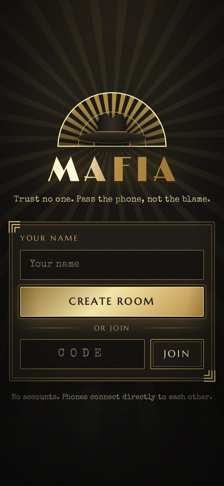
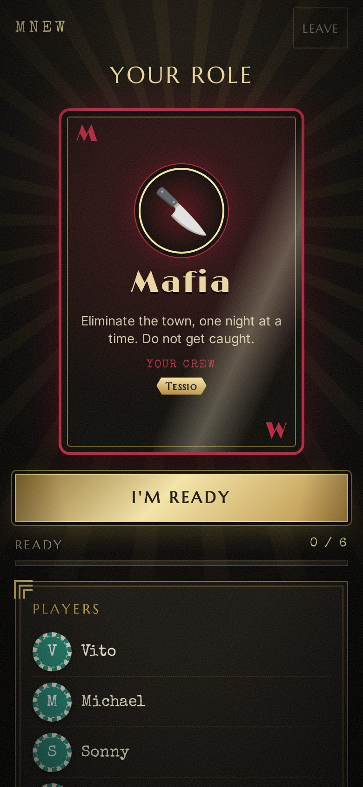
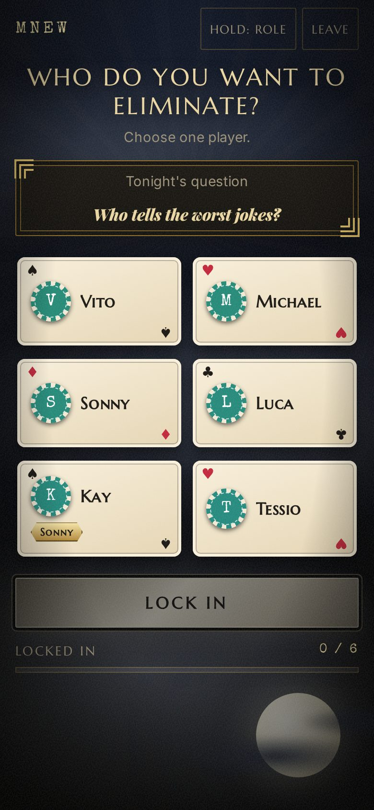
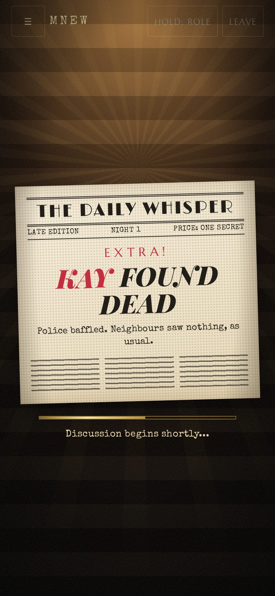
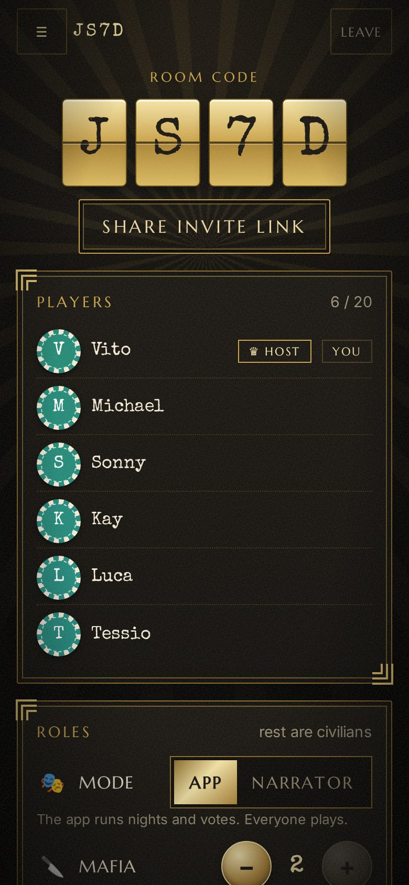
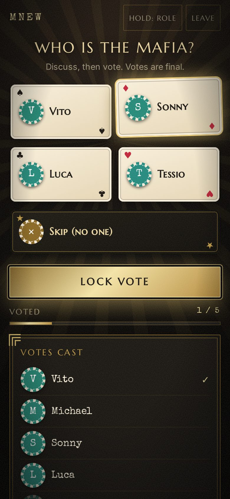
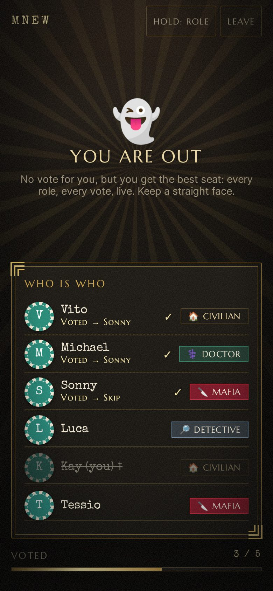
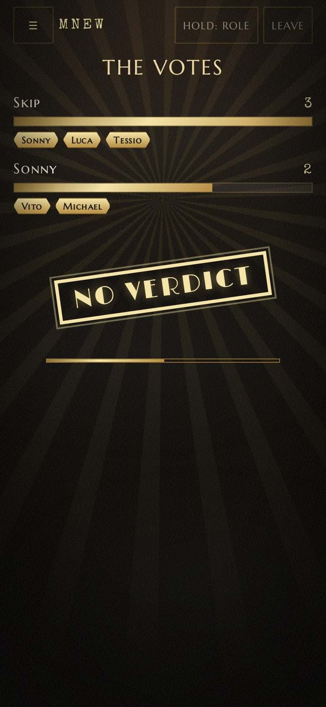
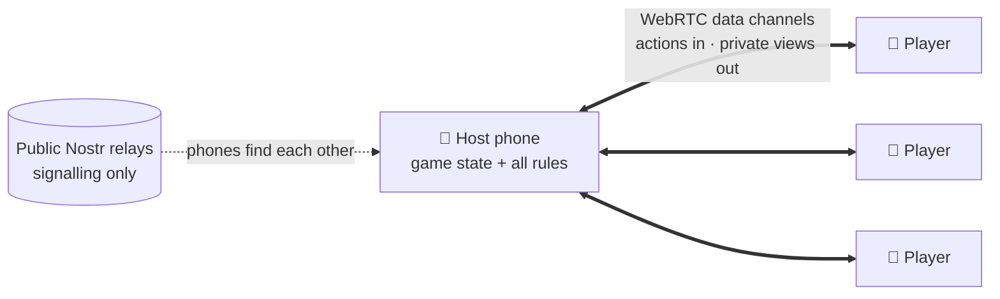

<div align="center">

# 🕴️ Mafia

**The party game of lies and deduction, played on the phones already in your pocket.**

No app to install, no accounts, no game server. Open the site, share a four-letter code, and play.

[](https://mafia-psi-ten.vercel.app/)


[](LICENSE)

<br>

&nbsp;
&nbsp;
&nbsp;


</div>

---

## Contents

- [Features](#features)
- [How to play](#how-to-play)
- [Roles](#roles)
- [Rules](#rules)
- [Game modes](#game-modes)
- [Screenshots](#screenshots)
- [How it works](#how-it-works)
- [Running locally](#running-locally)
- [Project structure](#project-structure)
- [Limitations](#limitations)
- [Acknowledgements](#acknowledgements)
- [License](#license)

## Features

- **Phone-first.** Built for a group sitting round a table, each on their own phone. Works on a laptop too.
- **Serverless multiplayer.** Phones connect directly over WebRTC; the room creator's phone referees the game.
- **Secret roles that stay secret.** Each phone only ever receives what its player is allowed to know. Roles hide themselves after a few seconds, and *Hold: role* shows yours only while pressed.
- **Fair dealing.** Across games in the same room, everyone gets a special role about equally often, so nobody is stuck as a civilian game after game. It stays a random draw, so the history doesn't give roles away.
- **Team nights.** Mafia, doctors and detectives see their teammates' picks live, change their minds, then lock in.
- **Night questions.** Everyone else answers a funny question at night ("Who would adopt 12 cats?"), so every phone looks busy and nobody gives themselves away. Answers are revealed in the *Gossip Column* at the end.
- **Ghosts stay in the game.** Dead players answer the night questions and, during the vote, see every role and every vote as it lands.
- **Narrator mode.** Prefer a human narrator? The app deals the roles and gives the narrator a private ledger to track deaths and the winner.
- **Built for real rooms.** Phones that sleep or reload reconnect to their seat, the host can resume an interrupted game, AFK players can be kicked, and a banner warns when phones are on different versions.
- **Speakeasy-noir design.** Art Deco styling with a split-flap room code, tarot-style role cards, a newspaper at dawn and a rubber stamp at the verdict. Animations respect *reduced motion*.

## How to play

1. **Create a room.** One person opens [the site](https://mafia-psi-ten.vercel.app/), enters a name and taps **Create room**. That phone is the host.
2. **Invite.** Everyone else enters the four-letter code (or opens the shared invite link) and joins.
3. **Set up.** The host chooses the number of mafia, doctors, detectives and jesters; everyone else is a civilian. The lobby blocks setups that can't work.
4. **Peek at your role.** Tap the card to see your role and, if you have one, your team. Tap **I'm ready**.
5. **Night.** Special roles act as a team; everyone else answers the night question. The night ends when everyone has locked in.
6. **Dawn.** Every phone reveals the same news at the same moment: who was killed, or that nobody died.
7. **Discuss and vote.** Argue it out, then vote someone out or skip. The tally is revealed together.
8. Repeat until one side wins.

> **Tip:** players should keep the page open. The game keeps the screen awake and reconnects automatically, and a new game in the same room needs no new code.

## Roles

| Role | Team | Each night |
|---|---|---|
| 🔪 **Mafia** | Mafia | Agree on one player to eliminate. Anyone alive is a valid target, a teammate or yourself included. |
| ⚕️ **Doctor** | Town | Agree on one player to save. You may save yourself from night 2 onwards (not on the first night), and nobody can be saved more than two nights in a row. |
| 🔎 **Detective** | Town | Agree on one player to investigate and learn whether they are Mafia. The jester reads as *not Mafia*. |
| 🃏 **Jester** | Alone | Answers the night question. Wins alone by getting voted out. |
| 🏠 **Civilian** | Town | Answers the night question. Finds the mafia by talking. |

## Rules

**Night**
- Each team (mafia, doctors, detectives) makes **one** choice. Members see each other's picks live and can change them until they lock in. Once every living member has locked, the most-picked player is chosen, and ties are broken at random.
- The mafia's target dies unless the doctors chose the same player. Deaths never reveal a role.
- Nobody can be the night-1 kill of two games in a row: the previous game's night-1 victim is off-limits to the mafia on night 1 only (unless that would leave the mafia no target), and fair game from night 2.
- Detectives see their result as soon as their team has locked in, and the night waits until each detective taps **Got it**.

**Day**
- Every living player votes for another player or **Skip**. Votes are final once locked.
- A player is voted out only with a clear plurality that also beats the Skip count. A tie or a Skip majority eliminates nobody.

**Winning**
| Winner | Condition |
|---|---|
| 🏙️ Town | No mafia left in play |
| 🔪 Mafia | Mafia equal or outnumber everyone else |
| 🃏 Jester | The jester is voted out (being killed at night does not count) |

**Dealing:** each game, special roles go out by a weighted random draw that favours players who have had fewer of them in this room; which special role they get is a plain shuffle.

**Setup limits:** 3 to 20 players, at least one mafia, fewer mafia than everyone else, and no more special roles than players. Names are up to 16 characters.

## Game modes

| | **App** (default) | **Narrator** |
|---|---|---|
| Who runs the game | The app | The host, out loud |
| Does the host play? | Yes | No, the host narrates |
| Nights, votes, questions | In the app | Around the table |
| What players see after the role reveal | Night and vote screens | A "look up, the Narrator is speaking" screen |
| What the host sees | Their own role only | Every role, and a ledger to mark players *killed*, *voted out* or *back in* |
| Winner | Detected automatically | Detected automatically from the ledger |

In both modes the host has a **☰ menu** to kick an unresponsive player at any time. A kicked player stays in the game (still votable, shown as *offline*), the table stops waiting for them, and they can rejoin with the code. Kicking the last mafia still in play ends the game in a town win.

## Screenshots

<div align="center">

| Lobby | Voting | A ghost's view | The verdict |
|:---:|:---:|:---:|:---:|
|  |  |  |  |

</div>

## How it works



- **No game server.** The site is static files on Vercel. [Trystero](https://github.com/dmotz/trystero) uses public Nostr relays only so phones can find each other; after that, all game traffic goes directly between phones over WebRTC.
- **The host is the referee.** The room creator's phone holds the game state and runs every rule in [`src/game.js`](src/game.js), a pure, framework-free module with no DOM or network code. Other phones only send actions (*select*, *lock*, *vote*) and render what they receive.
- **Private views.** After every change the host computes a separate view for each player (`viewFor`) containing only what that player may know: their own role, their team's live picks, a detective's results. No phone ever receives another player's role unless the rules allow it (teammates, the dead, game over).
- **Every action is validated.** The host checks the sender, phase, role, liveness and target of each action, so a modified client can't act out of turn.
- **Resilience.** Each device has a random session token, so a reconnecting phone reclaims its seat. The host's state is saved locally after every change, and reopening the site offers to resume the unfinished game. The host also tags each view with its build, so phones on a different deploy show a warning.
- **Night questions** come from the free [Truth or Dare Bot API](https://docs.truthordarebot.xyz/) (*Mild* = PG, *Spicy* = PG-13), prefetched during the day, with a built-in list of 30 as an offline fallback.

## Running locally

**Requirements:** Node.js 20+ and npm.

```bash
git clone https://github.com/Abhi-1122/mafia.git
cd mafia
npm install

npm run dev      # dev server at http://localhost:5173 (open several tabs to play against yourself)
npm test         # game-logic test suite (plain node:assert, no framework)
npm run build    # production build into dist/
npm run preview  # serve the production build
```

**Deploying:** import the repository on [Vercel](https://vercel.com/). It detects Vite automatically, and every push to `main` redeploys.

> Testing on real phones needs HTTPS (browsers only expose the Web Crypto API that Trystero relies on in a secure context), so use a Vercel preview deployment rather than a LAN address.

## Project structure

```
├── index.html          # page shell, fonts, animated backdrop layers
├── src/
│   ├── game.js         # pure game engine: state, rules, validation, per-player views
│   ├── game.test.js    # test suite for the engine (node src/game.test.js)
│   ├── net.js          # Trystero wrapper: host/client messaging, reconnects, build tagging
│   ├── main.js         # UI: screens, rendering, persistence, wake lock, question prefetch
│   └── style.css       # Speakeasy-noir theme and animations
├── docs/               # screenshots used in this README
└── PLAN.md             # original design spec and change log
```

The UI is plain DOM with a small `h()` element helper. Player-supplied text is always rendered with `textContent`, never `innerHTML`.

## Limitations

- **The host's phone knows every role.** It has to, in order to referee. The saved state is obfuscated, but someone determined, with developer tools, could read it. A truly cheat-proof game needs a server that holds the secrets.
- **The host is a single point of failure.** If the host's phone goes away for good, the game ends; reloads and short drops recover.
- **Strict networks.** Some mobile carriers and locked-down Wi-Fi block direct peer-to-peer connections. Adding a TURN relay to `TURN_SERVERS` in [`src/net.js`](src/net.js) fixes this.

## Acknowledgements

- [Trystero](https://github.com/dmotz/trystero) for serverless WebRTC rooms
- [Truth or Dare Bot](https://docs.truthordarebot.xyz/) for the night questions
- [Google Fonts](https://fonts.google.com/): Limelight, Marcellus SC, Playfair Display, Special Elite and Inter

## License

Released under the [MIT License](LICENSE).
